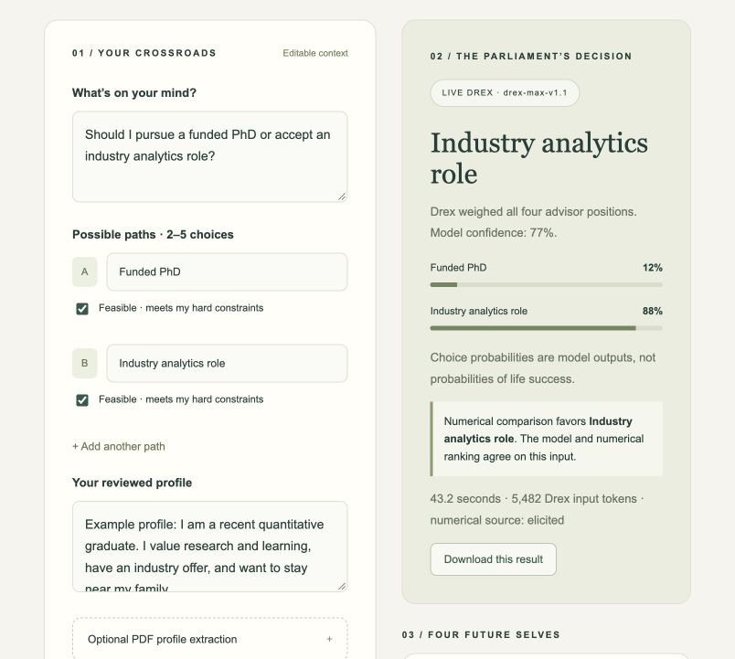

# Regret Simulator

**A Parliament of Future Selves — Drexathon 2026**

A working local decision-support app with four real Qwen advisors, Drex action selection and arbitration, optional NDI document grounding, and transparent scenario calculations.



## Start here

- [Run the app and understand its scope](frontend/README.md)
- [Final presentation — PowerPoint](frontend/presentation/Regret-Simulator-Final.pptx)
- [Final presentation — PDF](frontend/presentation/Regret-Simulator-Final.pdf)
- [Two-minute and five-minute demo scripts](frontend/docs/demo.md)
- [Prepared submission description](frontend/docs/submission.md)
- [Verification record](frontend/docs/verification.md)
- [Person A integration contract](frontend/docs/person-a-integration.md)

## Quick start

```sh
cd frontend
npm ci
# Copy .env.example to .env.local and set your own server-only NACE_API_KEY.
# Start Ollama and install qwen3:8b: ollama pull qwen3:8b
npm run doctor
npm run build
npm run start:local
```

Open http://127.0.0.1:3019. Demo mode works without model calls; Live mode uses local Ollama and the Nace API. `start:local` binds the server locally; the UI still defaults to Live mode.

Numerical outputs are calculations over explicit assumptions, not predictions of life outcomes. Person A's computer is not connected. The bundled app and reference analysis endpoint run independently.

No credentials, private supporting PDFs, unpublished research manuscript, or installed dependencies are included. This repository publication is not confirmation of organizer submission or acceptance.
